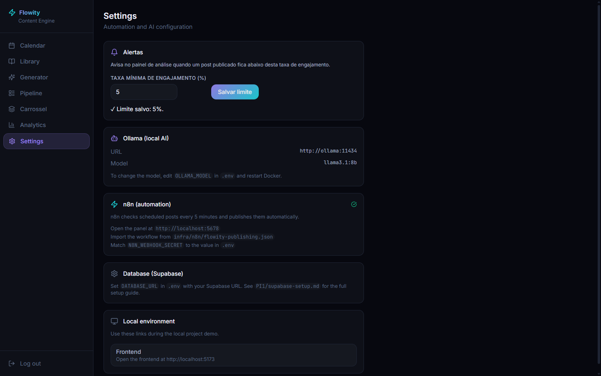
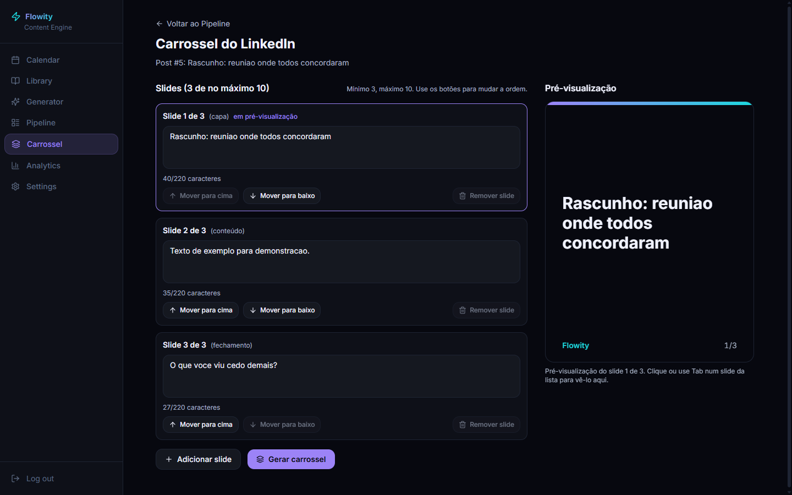
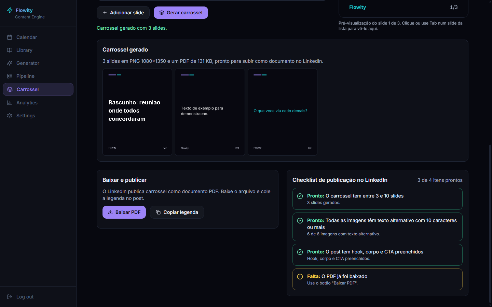
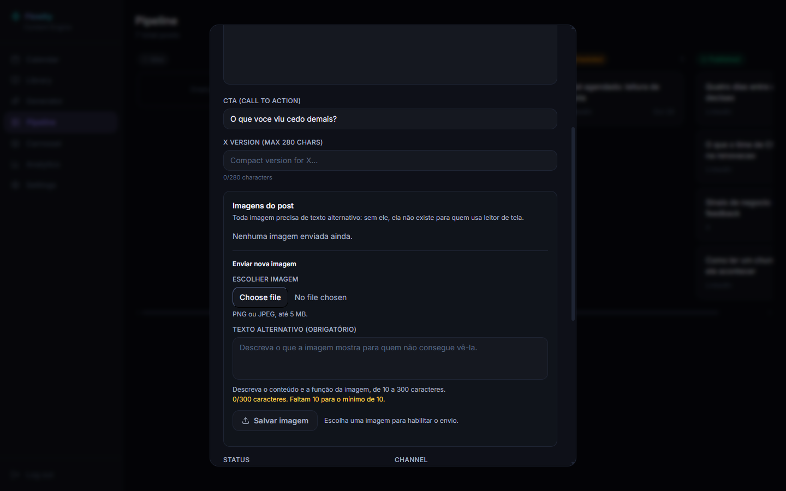

# Complemento — Telas novas do Flowity Content Engine (PI 2)

Este complemento continua o documento `docs/funcionamento-plataforma.md`, que cobre as imagens 01 a 08
(login, calendário, biblioteca, generator configuração e resultado, pipeline, modal de aprovação e
configurações de IA/automação). As telas abaixo foram acrescentadas no PI 2 e seguem a mesma numeração
(Imagem 09 em diante). O documento original não foi alterado.

Observação sobre as capturas: foram feitas em 27/10/2026 em uma instância local de demonstração, com banco
SQLite temporário e posts de exemplo (títulos como "Rascunho: o numero que importa"). Nenhum dado real do
Supabase aparece nas imagens. No SQLite o gráfico por dia da semana fica vazio; no PostgreSQL de produção
ele é preenchido.

---

## Imagem 09 — Análise das publicações (Analytics)

A tela **Analytics**, nova no menu lateral, mostra como as publicações estão performando:

- números gerais: quantidade de publicações, impressões, interações (curtidas, comentários e
  compartilhamentos) e taxa média de engajamento;
- gráfico de engajamento médio por dia da semana, para descobrir em que dia o público responde mais;
- comparação LinkedIn x X, com a taxa normalizada (interações divididas por impressões);
- faixa de alerta no topo, listando os posts publicados que ficaram abaixo do limite de engajamento
  definido nas configurações.

As métricas são registradas manualmente por post (números lidos no LinkedIn ou no X).

## Imagem 10 — Limite de engajamento nas configurações

Em **Settings**, o bloco **Alertas** guarda a taxa mínima de engajamento (em %). Quando um post
publicado fica abaixo desse valor, ele aparece na faixa de alerta da tela Analytics. O valor é salvo
no botão **Salvar limite** e vale para todos os posts.

## Imagem 11 — Editor de carrossel

A tela **Carrossel** (menu lateral, ou botão a partir de um post no Pipeline) transforma um post em um
carrossel do LinkedIn:

- de 3 a 10 slides, com capa, conteúdo e fechamento;
- texto de cada slide com contador (até 220 caracteres);
- botões para mover o slide para cima ou para baixo, remover e adicionar slide;
- pré-visualização ao lado, que acompanha o slide selecionado;
- navegação por teclado e leitor de tela (Tab percorre os slides).

O texto dos slides é salvo automaticamente e carregado de novo na próxima vez que o post é aberto.

## Imagem 12 — Carrossel gerado, PDF e checklist de publicação

Ao clicar em **Gerar carrossel**, a plataforma cria uma imagem PNG (1080x1350) por slide e um PDF único,
que é o formato aceito pelo LinkedIn para carrosséis. A tela mostra:

- as miniaturas dos slides gerados;
- **Baixar PDF** e **Copiar legenda**, para colar no post do LinkedIn;
- o **Checklist de publicação**: de 3 a 10 slides, texto alternativo em todas as imagens, hook, corpo e
  CTA preenchidos, e PDF já baixado.

## Imagem 13 — Imagem do post com texto alternativo obrigatório

No modal de revisão do post (Imagem 07 do documento original), o bloco **Imagens do post** permite
enviar uma imagem PNG ou JPEG de até 5 MB. O **texto alternativo é obrigatório**, de 10 a 300
caracteres, com contador e mensagem de ajuda. Sem ele o botão **Salvar imagem** continua desabilitado.
É a regra de acessibilidade do PI 2: nenhuma imagem sem descrição para quem usa leitor de tela.

---

## Fluxo atualizado

Source → Generator → Pipeline (rascunho) → revisão no modal (com imagem e texto alternativo) →
Carrossel (opcional, com PDF e checklist) → agendamento → publicação → registro de métricas →
Analytics e alertas de engajamento.

## Pendente de captura

Não foram capturadas nesta rodada, por dependerem de dados que o banco real ainda não tem: o gráfico
por dia da semana preenchido (exige PostgreSQL com métricas) e um post com imagem já enviada.
